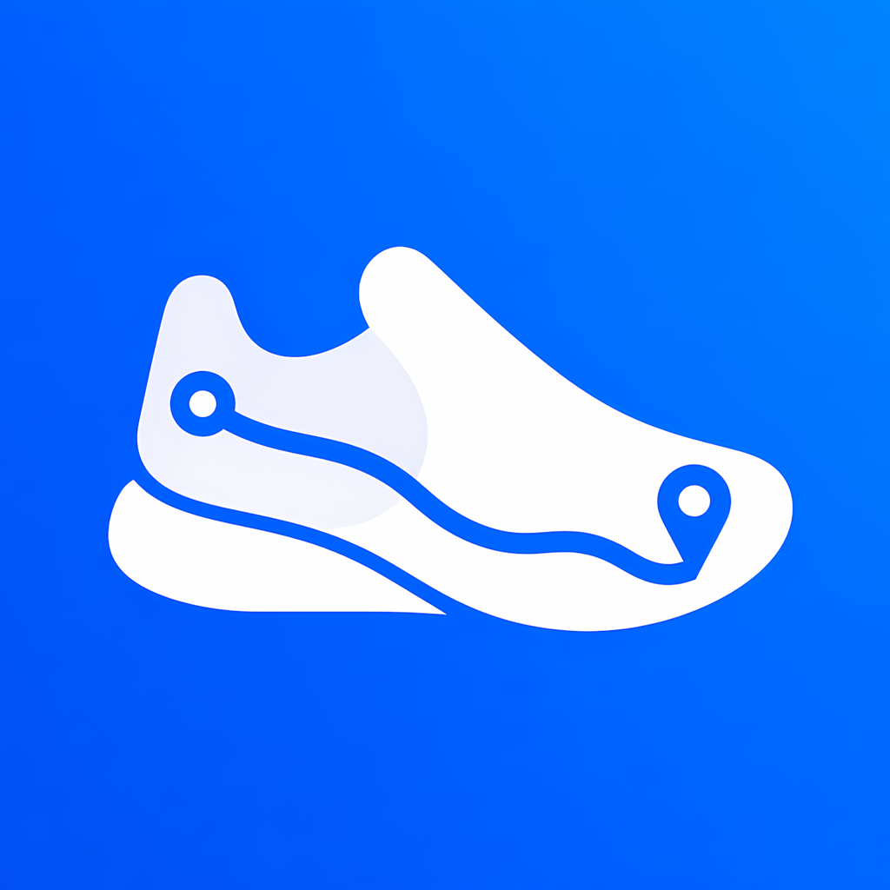

<h1 align="center">Hi 👋, I'm Yunus Balka</h1>
<h3 align="center">📱 Mobile Developer from Türkiye 🇹🇷</h3>

  Building engaging cross-platform mobile experiences with Flutter. 
  Passionate about clean architecture, thoughtful design, and creative problem-solving.

  
  
  

  

---

### 👨‍💻 About Me

- 🌐 Explore my personal website: **[balkayunus7.github.io](https://balkayunus7.github.io/)**
- 🚀 I build and publish mobile apps, from idea to App Store release.
- 🌱 Continuously improving my skills in **Flutter, Dart, and clean mobile architecture**.
- 💬 Ask me about **Flutter architecture, state management, and mobile app monetization**.
- 📫 Reach me at **[yunus.balka.ua5@gmail.com](mailto:yunus.balka.ua5@gmail.com)**.

---

<h3>🚀 My Apps</h3>

<table>
  <tr>
    <td width="110">
      
    </td>
    <td>
      <h3>Step Tourist</h3>
      
Explore the world, track your steps, and turn walking into an adventure.

      
    </td>
  </tr>
</table>
<!-- Add more app rows here as you publish new apps. -->

---

### 🛠️ Tech Stack & Tools

  
  
  
  
  
  

---

### 📫 Connect With Me

  <a href="https://balkayunus7.github.io/">🌐 Portfolio</a> &nbsp;•&nbsp;
  <a href="https://linkedin.com/in/yunus-balka">💼 LinkedIn</a> &nbsp;•&nbsp;
  <a href="https://github.com/balkayunus7">💻 GitHub</a> &nbsp;•&nbsp;
  <a href="mailto:yunus.balka.ua5@gmail.com">✉️ Email</a>

